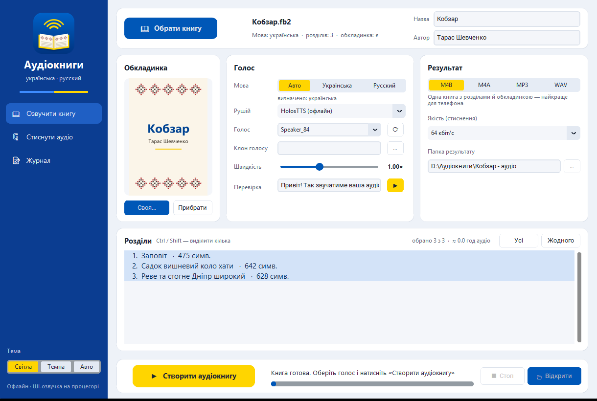
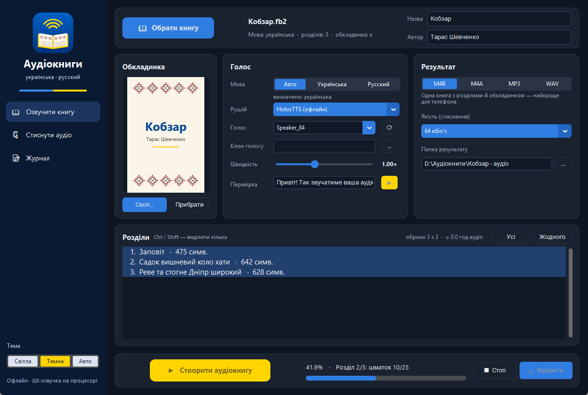

<p align="center">
  
</p>

<h1 align="center">Аудіокниги</h1>

<p align="center">
  Перетворює електронні книги на аудіокниги українською та російською.<br>
  Нейромережева (ШІ) озвучка працює <b>локально на процесорі</b>, без інтернету.
</p>

<p align="center">
  
  
</p>

## Можливості

- **Формати книг:** TXT, FB2 (і FB2.ZIP), EPUB, MOBI / AZW3, PDF.
  Розділи визначаються зі змісту книги; у PDF склеюються переноси й прибираються номери сторінок.
- **Українська озвучка:** [HolosTTS](https://github.com/patriotyk/HolosTTS). Десятки голосів, можна клонувати свій голос з WAV-зразка.
- **Російська озвучка:**
  - [Kokoro-RU](https://huggingface.co/zaakirio/kokoro-ru) (StyleTTS2, голоси dima, sveta, masha). Наголоси та «ё» ставить RUAccent.
  - [Silero TTS v5](https://github.com/snakers4/silero-models) (голоси xenia, baya, kseniya, aidar, eugene).
- **Мова визначається автоматично** за текстом книги.
- **Обкладинка вшивається** у файли: береться з EPUB/FB2/MOBI або з першої сторінки PDF, можна підставити свою картинку. На телефоні книга відображається з обкладинкою.
- **Стиснення:**
  - **M4B**: одна книга з розділами та обкладинкою, найкраще для телефона;
  - **M4A** або **MP3**: окремий файл на кожен розділ;
  - **WAV**: без стиснення.
- **Стиснення готового аудіо:** окрема вкладка перетворює папку з WAV/MP3 на M4B з розділами.
- **Можна зупинити й продовжити:** готові розділи при повторному запуску пропускаються.


## Встановлення (Windows)

Потрібні [Python 3.11+](https://www.python.org/downloads/) (з галочкою «Add python.exe to PATH») і [Git](https://git-scm.com/download/win).

```bat
git clone https://github.com/Krasul1a/audiobooks-ua.git
cd audiobooks-ua
install.bat
```

`install.bat` створює середовище `holos_env` і ставить усі залежності (PyTorch для процесора, ffmpeg, бібліотеки для книг і моделей).

## Запуск

- **Вікно програми:** `gui.bat`
- **Консоль:** `run.bat`, далі `python audiobook.py --help`

```bat
python audiobook.py книга.epub                              :: мова визначиться сама
python audiobook.py книга.fb2 --engine kokoro --voice dima
python audiobook.py книга.pdf --format mp3 --bitrate 96 --cover cover.jpg
python audiobook.py --convert "папка з wav" --format m4b    :: лише стиснути
```

Ручний наголос: `+` після наголошеної голосної, наприклад `за+мок` чи `замо+к`.

## Моделі

Під час першого запуску моделі завантажуються автоматично в папку `models/`:

| Рушій | Розмір | Звідки |
|---|---|---|
| HolosTTS | ~520 МБ | Hugging Face `patriotyk/HolosTTS` |
| Kokoro-RU | ~330 МБ | Hugging Face `zaakirio/kokoro-ru` |
| RUAccent (наголоси) | ~700 МБ | Hugging Face `ruaccent/accentuator` |
| Silero v5 | ~140 МБ | `models.silero.ai` |

Сайт `models.silero.ai` у деяких мережах недоступний. Тоді скачайте
[`v5_6_ru.pt`](https://models.silero.ai/models/tts/ru/v5_6_ru.pt) вручну (наприклад, через VPN) і покладіть у папку `models/`.

## Збірка exe

```bat
build_exe.bat
```

Результат: папка `dist\Аудіокниги` з `Аудіокниги.exe` і всіма моделями (≈3 ГБ). Її можна скопіювати на будь-який ПК з Windows: Python та інтернет там не потрібні.
Самоперевірка на новому ПК: `Аудіокниги.exe --selftest`, результат з'явиться в папці `selftest`.

## Швидкість

Скільки часу займає одна година аудіо (лише процесор):

| Рушій | Час на годину аудіо | Де виміряно |
|---|---|---|
| Silero v5 | ~6–7 хв | процесор на 12 потоків |
| Kokoro-RU | ~12–14 хв | процесор на 12 потоків |
| HolosTTS | ~5 хв | i7-13700K, дані автора моделі |

Перший запуск кожного рушія довший, бо модель завантажується в пам'ять.

## Ліцензії моделей

Код цього проєкту відкритий, але **моделі мають власні ліцензії**:

- HolosTTS: MIT. Автор зазначає, що вбудовані голоси використані без згоди їхніх власників; для комерційного використання клонуйте власний голос.
- Kokoro-RU: OpenRAIL.
- Silero TTS: CC BY-NC 4.0, **лише некомерційне використання**.
- RUAccent: Apache-2.0.

## Подяки

[patriotyk](https://github.com/patriotyk) за HolosTTS, 
